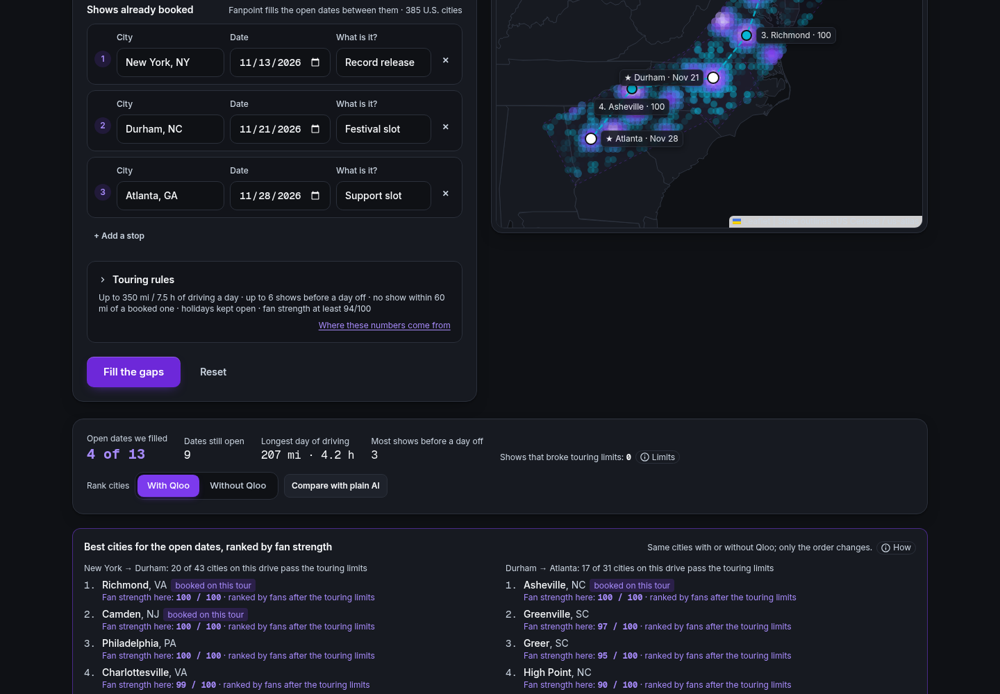
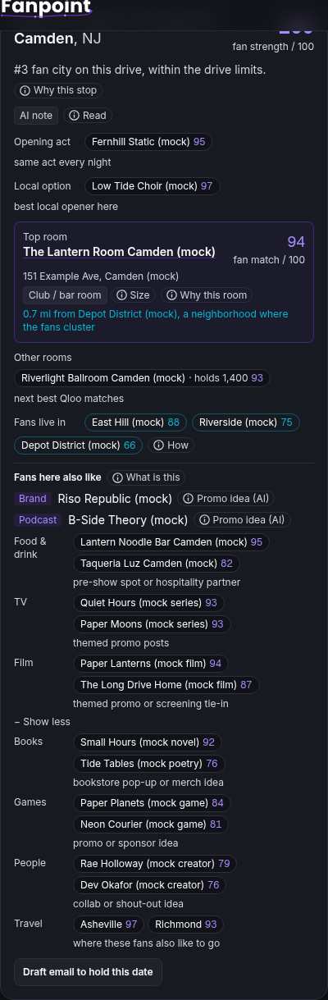
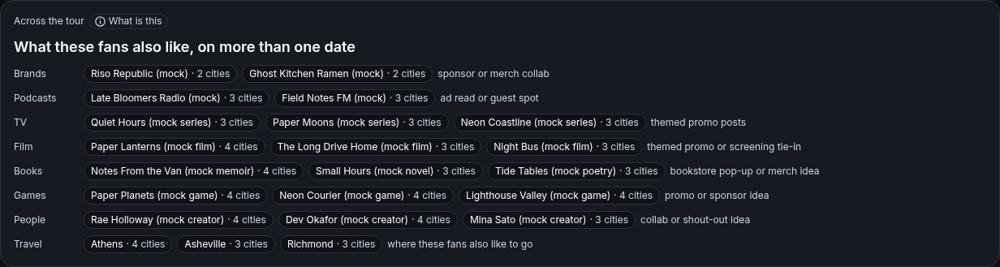
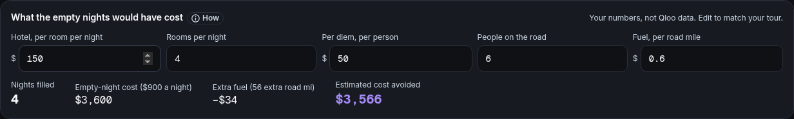
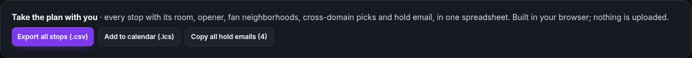
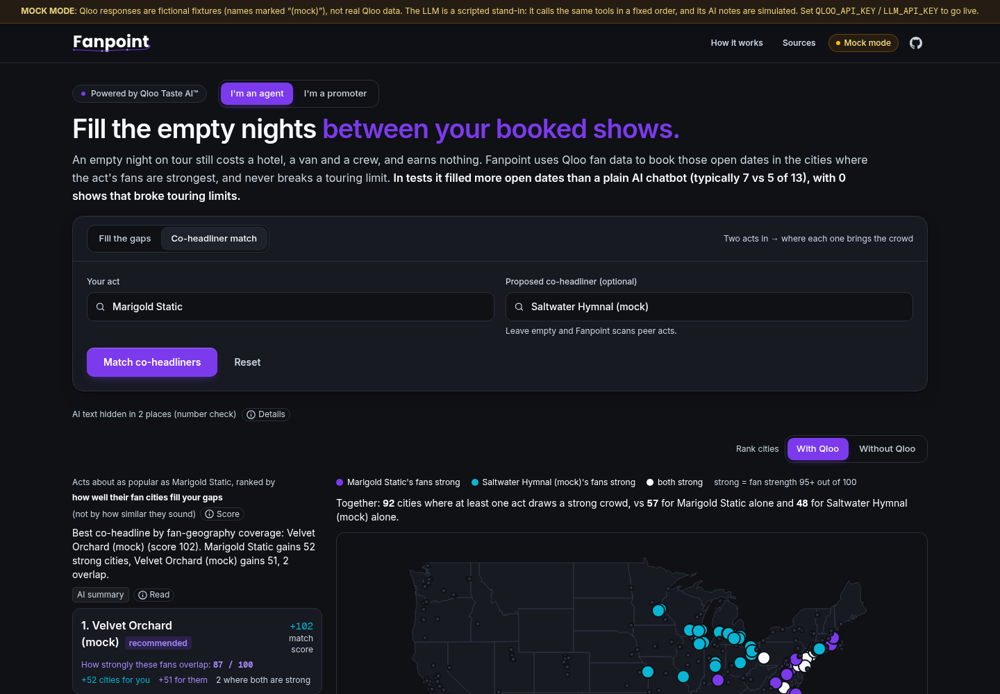

# Fanpoint

**Fanpoint is a tour routing desk for booking agents and promoters.** It fills the empty nights between an act's booked shows. An empty night still costs hotel rooms, per diems and fuel, and earns nothing. Fanpoint turns Qloo taste intelligence into booked nights, avoided cost, **and ready-to-pitch sponsor & ad opportunities**: Qloo data ranks the fan cities, rooms, openers and cross-domain sponsor hooks, code enforces the touring rules, and the plan leaves as a CSV and hold requests. It is not a fan-facing tour finder. It answers two routing questions with
[Qloo Taste AI™](https://docs.qloo.com/) data:

1. **Fill the gaps.** Fixed dates in, gap cities with real road miles and drive hours out. Enter the shows that are already confirmed
   (a festival slot, a support date, a hometown show). Fanpoint fills the off days in between with the cities where the
   act's fans are strongest *and* that a van can actually reach. The goal is fewer empty nights on the routing.
2. **Co-headliner match.** Two acts in, a complementary fan map out. Fanpoint compares both acts' nationwide Qloo fan
   heatmaps and scores **complementarity**: where act A is strong and act B is weak, and the reverse. The map is coloured
   by which act carries each city. The goal is a co-bill where each act brings its own strong markets.

**Fanpoint's decisions are computed in code from sourced data.** Fan affinity comes from Qloo Insights heatmaps. Road
miles and hours come from OSRM on OpenStreetMap. The 385-city market universe, populations and metro areas come from
the U.S. Census Bureau, and venue counts from OpenStreetMap. Every touring rule is either cited or labelled as an
adjustable assumption ([`docs/SOURCES.md`](docs/SOURCES.md), and the **Sources & methodology** panel in the app).

The LLM only orchestrates the tool calls and explains the result. It does not choose cities, support acts, rooms,
promo partners or recommended co-headliners, and any number in its text must match the data, or the text is dropped
with a warning. Every Qloo request is shown in the agent trace. A **Fanpoint + Qloo / Plain AI / Compare** toggle runs the same anchors through the same LLM with no
Qloo access and audits that plan with the same touring rules.

> **Mock mode.** Without API keys Fanpoint runs on clearly labeled **mock fixtures**: fictional acts ("Marigold Static",
> "Saltwater Hymnal (mock)"…) with hand-made fan geography over real US city coordinates. Mock mode is **not** Qloo data, and the
> banner says so on every screen. Without an LLM key, the plain-AI baseline is a **simulated** heuristic (labeled SIMULATED),
> not a model output. Add keys ([`docs/ENV.md`](docs/ENV.md)) and the identical code path goes live.








Screenshots in `screens/` are mock-mode captures of the current build (fictional "(mock)" acts). Live captures stay out of the repo (Qloo terms; see `docs/DEPLOY.md`).

## What you see

- **Map first.** The form sits beside the route map, so the map is visible on first load; the result stats read in plain English ("Open dates we filled 8 of 13", "Shows that broke touring limits: 0").
- **Plain-English labels.** "fans" (not "heat"), "open" (not "OFF"), "too few fans", "too close to a booked show". Longer explanations sit behind ⓘ info buttons; the Qloo request log sits behind **Show trace**. Text is at least 12 px.
- **Sponsor & Ad Opportunities.** Every filled stop surfaces ready-to-pitch sponsor and ad hooks drawn from Qloo taste data (strongest brands and podcasts first). These are data-backed ideas for promoters and agents to use in outreach.
- **Fans here also like.** Every filled stop lists what the act's fans in that city also like outside music, from Qloo: brands (fashion brands marked from Qloo's own tags), podcasts, food and drink, TV, film, books, video games, people and travel destinations. Each row carries a fixed plain-English use (sponsor or merch collab, ad read or guest spot, pre-show spot or hospitality partner, themed promo…). An **Across the tour** card lists the picks that come up in two or more filled cities. Names are Qloo results picked in code; only the promo ideas marked "AI" are model-written, and number-checked.
- **Rooms and holds.** Each stop shows Qloo's top room and the next best one. **Copy hold request** copies that stop's hold email (built from the plan, no AI); **Draft email to hold this date** opens it to read first. Nothing is sent.
- **What the empty nights would have cost.** Below the stop cards: nights filled × (hotel × rooms + per diem × people), minus fuel for the extra road miles versus driving straight between the booked shows (OSRM). Defaults ($150 a room, 4 rooms, $50 per diem, 6 people, $0.60 a mile) are visible and editable; they are planning assumptions, not Qloo data.
- **Take the plan with you.** **Export all stops (.csv)** downloads one row per filled stop: date, city, fan strength, drive, top and other rooms, opening act, local opener, fan neighborhoods, cross-domain picks and the hold email. Built in the browser. Also **Add to calendar (.ics)** and **Copy all hold emails**.
- **Receipts behind a toggle.** Every city considered (and why it was or wasn't booked) and the full agent trace with every Qloo call sit in one **Receipts** section, closed by default.

## Who it's for

Booking agents, tour managers and regional promoters who already hold anchor dates and need to decide what goes in
between, or which act to pair on a co-bill. It is a routing desk, not an artist dashboard.

## How it uses Qloo

All calls are `GET https://hackathon.api.qloo.com/...` with `X-Api-Key`, made server-side only.

| Decision | Endpoint and key params | What Fanpoint does with it |
|---|---|---|
| Which act | `/search?query=…&types=urn:entity:artist` | Entity id used as the signal for every later call |
| Where the fans are **along each drive** | `/v2/insights?filter.type=urn:heatmap&signal.interests.entities=<act>&filter.location=POLYGON(<corridor>)` | One heatmap per anchor-to-anchor corridor (a buffered polygon around the leg). Each touring city takes the strongest cell within 5 mi (15 mi on the coarser lower-48 heatmap), and cities are ranked by that fan heat |
| Fallback city ranking | `/v2/insights?filter.type=urn:entity:destination&signal.interests.entities=…&filter.location=POLYGON(…)` | Used only if a corridor heatmap returns no cells |
| Room category | `/v2/tags?filter.query=music venue&filter.tag.types=urn:tag:category:place` | Venue tag id |
| Rooms per fill | `/v2/insights?filter.type=urn:entity:place&signal.interests.entities=…&filter.location=POINT(<market centre>)&filter.location.radius=16000&filter.tags=<venue tags>` | Rooms whose crowd matches the act |
| Support act per fill | `/v2/insights?filter.type=urn:entity:artist&signal.interests.entities=…&signal.location.query=<city>&filter.exclude.entities=…&filter.popularity.max=<act popularity>` | Local, taste-adjacent, no bigger than the act |
| Promo hooks per fill | `urn:entity:brand` and `urn:entity:podcast` with `signal.location.query=<city>` | Cross-domain partner ideas |
| Fans here also like (per fill, in code after routing) | `urn:entity:tv_show`, `urn:entity:movie`, `urn:entity:book`, `urn:entity:videogame`, `urn:entity:person`, `urn:entity:destination` with `signal.location.query=<city>`; restaurants: `urn:entity:place` + `filter.tags=urn:tag:category:place:restaurant` + the market POINT/radius | Cross-domain taste per stop and across the tour. Places are kept only if their Qloo category is food or drink. A category that returns 403 or errors is dropped for the rest of the run; one that is empty is left off that stop. All nine categories returned data on live Qloo (2026-10-30) |
| Co-headliner candidates | `/v2/insights?filter.type=urn:entity:artist&signal.interests.entities=…&filter.popularity.min/max=<band>` | Peers in the act's popularity band |
| Complementarity | `/v2/insights?filter.type=urn:heatmap&signal.interests.entities=<each act>&filter.location=POLYGON(lower 48)` | Per-city fan heat for both acts, then the score below |

**Complementarity score** (Fanpoint's formula, computed in code): with *strong* = fan heat ≥ 0.95 and *weak* < 0.91 (live-calibrated: an act's top quarter and bottom 60% of markets, see `docs/SOURCES.md`),
`score = youGain + theyGain − 0.5·|youGain − theyGain| − 0.25·overlap`. Here *youGain* is the cities weak for you and strong for
them, and *theyGain* is the reverse. It rewards two-way coverage and penalises one-sided deals and pure overlap.
The most taste-*similar* peer is shown next to it, because similar acts usually share the same cities.

## Data and touring rules (all sourced or labelled)

Full list with links, licenses and dates: [`docs/SOURCES.md`](docs/SOURCES.md). Every constant is in a single file,
[`src/lib/touring/rules.ts`](src/lib/touring/rules.ts), with its citation. The UI renders that file, so the screen and
the code always show the same values.

| Data | Source | License |
|---|---|---|
| Fan affinity, support acts, rooms, promo partners, peers | Qloo Taste AI™ Insights API | Qloo API terms |
| Road miles and hours (all 148,225 ordered market pairs) | OSRM car profile on OpenStreetMap, **precomputed once** (16 requests to the demo server at ≤1 req/s) | © OpenStreetMap contributors, ODbL. OSRM is BSD-2 |
| 385 markets, population, metro areas | U.S. Census Bureau: OMB CBSA delineation (July 2023), Vintage 2025 estimates, 2025 Gazetteer | Public domain |
| City centres, venue counts within 10 mi | OpenStreetMap via Overpass (2 bulk requests per build) | © OpenStreetMap contributors, ODbL |

| Rule | Default | Status |
|---|---|---|
| Max drive time | 7.5 h/day (OSRM hours) | Sourced: Road Safety Scotland fatigue guidance. The FMCSA 10 h ceiling is cited for contrast |
| Max shows in a row | 6 (anchors count) | Adapted: AFM Pamphlet B, one day off per week |
| Radius clause | 60 mi, straight line | Sourced: the "standard club radius" template (SystemOne), plus How To Concerts and infract |
| Max drive distance | 350 road mi/day | Assumption (adjustable) |
| Night-of-week weights | Sun .70 · Mon .55 · Tue .65 · Wed .75 · Thu .90 · Fri/Sat 1.0 | Assumption. The direction (weekends sell more) is cited, the exact values are Fanpoint's |
| Night floor, heat floor | 0.45, 0.94 (live-calibrated) | Assumption (adjustable) |
| No doubling back, spacing, corridor width, strong/weak thresholds, co-headline weights | 25 / 10 mi, 50 mi, 90 mi, 0.95 / 0.91 (live-calibrated), 0.5 / 0.25 | Assumptions, set in `rules.ts` |

The fill is a deterministic dynamic programme per gap. It maximises Qloo heat × night weight minus the night floor,
subject to every rule, with the consecutive-shows count carried across gaps. The **filter that removes unrealistic
cities** is shown per corridor: every scanned city is listed with its fan heat and status (picked, radius clause, off
route or backtrack, below heat floor, no road route, or didn't fit schedule).

Each stop card shows **Why this stop**, with a source on every line:

- Qloo fan heat and rank in the corridor
- OSRM road miles and hours from the previous show
- the night weight, marked as an assumption
- Census city and metro population
- OpenStreetMap venue count, with a map link

Rebuild the data: `python3 scripts/data/build_markets.py` (Python 3.10+, `openpyxl`). The outputs are committed, so the
app calls no routing or Overpass service at runtime.

## Architecture

```
Browser ─POST /api/plan─▶ agent loop (src/lib/agent/run.ts) ─NDJSON events─▶ calendar · corridor heat map · filter · trace
                            │  LLM adapter: OpenAI-compatible tool calling | scripted mock
                            ▼
                         tools (src/lib/agent/tools.ts)
                            fill:   resolve_artist → scan_corridor ×gaps → fill_gaps (code) → get_city_intel ×fills → submit_fill
                                    (on submit, in code: run_support, then cross_domain "Fans here also like")
                            cohead: resolve_artist (+partner) → find_peer_acts → compare_fan_geography (code) → submit_cohead
                            │
                            ▼
                         Qloo adapter (src/lib/qloo): HttpQlooClient (live) | MockQlooClient (fixtures)
                            └─ src/lib/net: timeouts, retries with backoff, rate limiter · zod response schemas
```

| Module | Role |
|---|---|
| `src/lib/touring/rules.ts` | Every rule constant, with its citation and status (client-safe) |
| `src/lib/data/markets.ts`, `markets.json` | Census + OSM market universe (client-safe) |
| `src/lib/route/road.ts`, `road-matrix.json` | Precomputed OSRM road matrix (server-only) |
| `scripts/data/build_markets.py` | Offline build of both datasets, with polite rate limits and a cache |
| `src/lib/route/fill.ts` | Gap-filling DP, touring rules, plain-AI audit (pure; the road function is injected) |
| `src/lib/agent/narrative.ts` | Number check for model-written text |
| `src/lib/cohead/complementarity.ts` | Co-headliner score (pure) |
| `src/lib/qloo/schemas.ts`, `src/lib/llm/schemas.ts` | Runtime validation of every Qloo and LLM response |
| `src/lib/net/*` | `ProviderError`, retry/backoff/timeout, rate limiter |
| `src/lib/agent/*` | Agent loop, tools (zod-validated arguments), grounding filter |
| `src/lib/api/plan-request.ts` | Input validation for `POST /api/plan` |
| `src/lib/client/stream.ts` | Browser NDJSON reader that maps every failure to a typed error |

- **Decisions in code, explanations from the model.** `fill_gaps` takes no arguments, and the corridor width, peer
  count and peers compared are fixed in code. Support acts, rooms and promo partners are the top Qloo result per city.
  Recommended co-headliners are the top 3 positive scores. If the model skips `get_city_intel`, Fanpoint fetches it.
  Headlines, "why" text and summaries are generated from the data. The model's notes, angles, pitches and summary are
  checked by `vetText` (`src/lib/agent/narrative.ts`): any number not found in the data drops the text and adds a warning.
- **Grounding:** entity ids must come from earlier tool calls. Anything else is dropped and counted.
- **Data handling:** Qloo responses are cached in server memory (6 h) only. No live Qloo data is written to disk or committed.
  All fixtures are synthetic: `src/lib/qloo/fixtures/` (mock demo data) and `tests/fixtures/qloo-shapes/` (response envelopes that follow the field names in Qloo's public docs, with placeholder values).

## Reliability and safety

- **Timeouts and retries.** Qloo: same policy as Qloo's own client (`@qloo/qloo-harness`): 20 s per attempt, 3 attempts in total, retries only on 429/500/502/503/504, network errors and timeouts, honours `Retry-After`, and rejects bodies over 5 MB. LLM: 45 s per attempt, 3 retries, also retries 408/425, and honours a 429's `Retry-After` header or Google's `RetryInfo.retryDelay` body field (capped at 30 s). On Gemini's free tier, calls are spaced 6.5 s apart (`LLM_MIN_INTERVAL_MS`). Other 4xx are never retried. `LLM_API_KEY` is only sent to Gemini's or OpenAI's API host unless `LLM_TRUSTED_BASE_URL` names another one exactly; the Qloo key only goes to Qloo hosts.
- **Qloo 401 vs 403.** Per Qloo's hackathon developer guide, 401 means a bad key or the wrong host, so the run stops with "API key rejected". 403 means this entity type isn't enabled for the key, so only that list is skipped, with a warning.
- **Base-URL allowlist.** The Qloo key is only sent over https to `hackathon.api.qloo.com` or `api.qloo.com`. Any other `QLOO_BASE_URL` (a proxy or a local mock) must also be set, exactly, in `QLOO_TRUSTED_BASE_URL`. Otherwise the run stops with a config error before any request goes out.
- **Rate limit.** Request starts are spaced ≥ 220 ms apart per process (~4.5 req/s). Qloo doesn't publish a number; the developer guide only says limits are "set high enough" and can be raised on Discord, so this is a self-imposed ceiling. Each run is also capped at 150 Qloo network calls to protect the monthly quota.
- **Validation.** Every Qloo and LLM response is checked with zod. A wrong envelope fails that call with `invalid_response`; single bad items (an entity without an id, a heat cell without affinity) are dropped and counted in the trace. Tool arguments from the model are validated against the same schemas that generate the tool definitions, and the user's touring rules always override the model's.
- **Graceful degradation.** Cross-domain lookups ("Fans here also like") never fail a run: any error just leaves that category out, and they stop at 135 Qloo calls so the 150-call cap is never reached. A live fill makes about 65–101 Qloo calls (5–8 filled cities, measured 2026-10-30). A failed corridor heatmap falls back to Qloo destination insights; if both fail, that gap stays open and the result says so. One failed city-intel sub-call only empties that list. A failed peer heatmap drops that peer. These show as "Partial data" warnings next to the plan.
- **Clear errors.** Fatal problems (bad key, rate limited after retries, budget, LLM down) end the run with a typed error. The UI shows what happened, which provider, and a "Try again" button when retrying can help.
- **Keys stay on the server.** `config.ts` and both HTTP clients import `server-only`, so the build fails if a client component imports them. CI builds with canary key values and `npm run check:bundle` proves that neither the values nor server-only markers (Qloo host, `X-Api-Key`, `/chat/completions`) appear in the client bundle.
- **API input.** `POST /api/plan` accepts JSON only (415 otherwise), ≤ 8 KB (413), strict schemas (unknown keys rejected), real calendar dates, 2–4 anchors with distinct dates and cities, a tour of ≤ 45 days, and printable text.

## Testing

```bash
npm test             # unit + integration tests (Vitest), mock mode, no keys needed
npm run coverage     # same, with a coverage report in coverage/ and thresholds enforced
npm run typecheck    # tsc --noEmit (strict, noUncheckedIndexedAccess)
npm run lint
npm run ci           # everything CI runs: lint, typecheck, coverage, build, bundle check
```

- `tests/fill.test.ts`: the gap-filling DP. Drive limits (miles and hours), consecutive shows, reachability, no backtracking, radius clause, spacing, night-of-week weights, adjacent and impossible gaps, no candidates. Property tests check every rule on 300 random corridors and compare the DP against brute force on 150 small cases.
- `tests/cohead-grounding.test.ts`: complementarity scoring and the grounding filter.
- `tests/qloo-parsers.test.ts`, `tests/clients.test.ts`: response parsers on the fixture shapes from Qloo's docs, plus the live clients against a scripted `fetch` (retries, timeouts, auth, invalid bodies, cache, budget).
- `tests/net.test.ts`: backoff, `Retry-After`, rate limiter, status mapping, body-size cap.
- `tests/base-url.test.ts`: the Qloo base-URL allowlist.
- `tests/agent.integration.test.ts`: full agent loop on mock fixtures.
