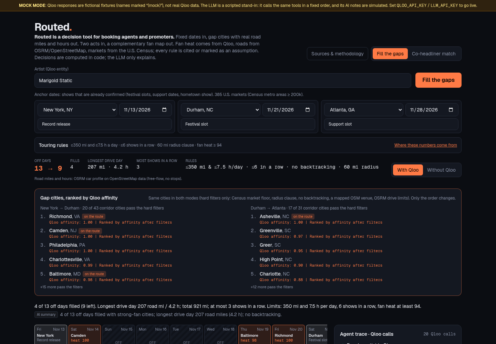
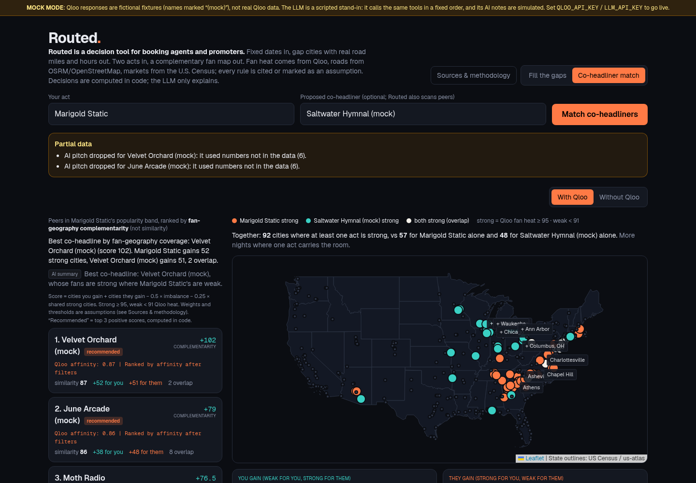

# Routed

**Routed is a decision tool for booking agents and promoters.** It answers two routing questions with
[Qloo Taste AI™](https://docs.qloo.com/) data:

1. **Fill the gaps.** Fixed dates in, gap cities with real road miles and drive hours out. Enter the shows that are already confirmed
   (a festival slot, a support date, a hometown show). Routed fills the off days in between with the cities where the
   act's fans are strongest *and* that a van can actually reach. The goal is fewer empty nights on the routing.
2. **Co-headliner match.** Two acts in, a complementary fan map out. Routed compares both acts' nationwide Qloo fan
   heatmaps and scores **complementarity**: where act A is strong and act B is weak, and the reverse. The map is coloured
   by which act carries each city. The goal is a co-bill where each act brings its own strong markets.

**Routed's decisions are computed in code from sourced data.** Fan affinity comes from Qloo Insights heatmaps. Road
miles and hours come from OSRM on OpenStreetMap. The 385-city market universe, populations and metro areas come from
the U.S. Census Bureau, and venue counts from OpenStreetMap. Every touring rule is either cited or labelled as an
adjustable assumption ([`docs/SOURCES.md`](docs/SOURCES.md), and the **Sources & methodology** panel in the app).

The LLM only orchestrates the tool calls and explains the result. It does not choose cities, support acts, rooms,
promo partners or recommended co-headliners, and any number in its text must match the data, or the text is dropped
with a warning. Every Qloo request is shown in the agent trace. A **Routed + Qloo / Plain AI / Compare** toggle runs the same anchors through the same LLM with no
Qloo access and audits that plan with the same touring rules.

> **Mock mode.** Without API keys Routed runs on clearly labeled **mock fixtures**: fictional acts ("Marigold Static",
> "Saltwater Hymnal (mock)"…) with hand-made fan geography over real US city coordinates. Mock mode is **not** Qloo data, and the
> banner says so on every screen. Without an LLM key, the plain-AI baseline is a **simulated** heuristic (labeled SIMULATED),
> not a model output. Add keys ([`docs/ENV.md`](docs/ENV.md)) and the identical code path goes live.




## Who it's for

Booking agents, tour managers and regional promoters who already hold anchor dates and need to decide what goes in
between, or which act to pair on a co-bill. It is a routing desk, not an artist dashboard.

## How it uses Qloo

All calls are `GET https://hackathon.api.qloo.com/...` with `X-Api-Key`, made server-side only.

| Decision | Endpoint and key params | What Routed does with it |
|---|---|---|
| Which act | `/search?query=…&types=urn:entity:artist` | Entity id used as the signal for every later call |
| Where the fans are **along each drive** | `/v2/insights?filter.type=urn:heatmap&signal.interests.entities=<act>&filter.location=POLYGON(<corridor>)` | One heatmap per anchor-to-anchor corridor (a buffered polygon around the leg). Each touring city takes the strongest cell within 5 mi (15 mi on the coarser lower-48 heatmap), and cities are ranked by that fan heat |
| Fallback city ranking | `/v2/insights?filter.type=urn:entity:destination&signal.interests.entities=…&filter.location=POLYGON(…)` | Used only if a corridor heatmap returns no cells |
| Room category | `/v2/tags?filter.query=music venue&filter.tag.types=urn:tag:category:place` | Venue tag id |
| Rooms per fill | `/v2/insights?filter.type=urn:entity:place&signal.interests.entities=…&filter.location.query=<city>&filter.tags=<venue tag>` | Rooms whose crowd matches the act |
| Support act per fill | `/v2/insights?filter.type=urn:entity:artist&signal.interests.entities=…&signal.location.query=<city>&filter.exclude.entities=…&filter.popularity.max=<act popularity>` | Local, taste-adjacent, no bigger than the act |
| Promo hooks per fill | `urn:entity:brand` and `urn:entity:podcast` with `signal.location.query=<city>` | Cross-domain partner ideas |
| Co-headliner candidates | `/v2/insights?filter.type=urn:entity:artist&signal.interests.entities=…&filter.popularity.min/max=<band>` | Peers in the act's popularity band |
| Complementarity | `/v2/insights?filter.type=urn:heatmap&signal.interests.entities=<each act>&filter.location=POLYGON(lower 48)` | Per-city fan heat for both acts, then the score below |

**Complementarity score** (Routed's formula, computed in code): with *strong* = fan heat ≥ 0.95 and *weak* < 0.91 (live-calibrated: an act's top quarter and bottom 60% of markets, see `docs/SOURCES.md`),
`score = youGain + theyGain − 0.5·|youGain − theyGain| − 0.25·overlap`. Here *youGain* is the cities weak for you and strong for
them, and *theyGain* is the reverse. It rewards two-way coverage and penalises one-sided deals and pure overlap.
The most taste-*similar* peer is shown next to it, because similar acts usually share the same cities.

## Data and touring rules (all sourced or labelled)

Full list with links, licenses and dates: [`docs/SOURCES.md`](docs/SOURCES.md). Every constant is in a single file,
[`src/lib/touring/rules.ts`](src/lib/touring/rules.ts), with its citation. The UI renders that file, so the screen and
the code always show the same values.

| Data | Source | License |
|---|---|---|
| Fan affinity, support acts, rooms, promo partners, peers | Qloo Taste AI™ Insights API | Qloo API terms |
| Road miles and hours (all 148,225 ordered market pairs) | OSRM car profile on OpenStreetMap, **precomputed once** (16 requests to the demo server at ≤1 req/s) | © OpenStreetMap contributors, ODbL. OSRM is BSD-2 |
| 385 markets, population, metro areas | U.S. Census Bureau: OMB CBSA delineation (July 2023), Vintage 2025 estimates, 2025 Gazetteer | Public domain |
| City centres, venue counts within 10 mi | OpenStreetMap via Overpass (2 bulk requests per build) | © OpenStreetMap contributors, ODbL |

| Rule | Default | Status |
|---|---|---|
| Max drive time | 7.5 h/day (OSRM hours) | Sourced: Road Safety Scotland fatigue guidance. The FMCSA 10 h ceiling is cited for contrast |
| Max shows in a row | 6 (anchors count) | Adapted: AFM Pamphlet B, one day off per week |
| Radius clause | 60 mi, straight line | Sourced: the "standard club radius" template (SystemOne), plus How To Concerts and infract |
| Max drive distance | 350 road mi/day | Assumption (adjustable) |
| Night-of-week weights | Sun .70 · Mon .55 · Tue .65 · Wed .75 · Thu .90 · Fri/Sat 1.0 | Assumption. The direction (weekends sell more) is cited, the exact values are Routed's |
| Night floor, heat floor | 0.45, 0.94 (live-calibrated) | Assumption (adjustable) |
| No doubling back, spacing, corridor width, strong/weak thresholds, co-headline weights | 25 / 10 mi, 50 mi, 90 mi, 0.95 / 0.91 (live-calibrated), 0.5 / 0.25 | Assumptions, set in `rules.ts` |

The fill is a deterministic dynamic programme per gap. It maximises Qloo heat × night weight minus the night floor,
subject to every rule, with the consecutive-shows count carried across gaps. The **filter that removes unrealistic
cities** is shown per corridor: every scanned city is listed with its fan heat and status (picked, radius clause, off
route or backtrack, below heat floor, no road route, or didn't fit schedule).

Each stop card shows **Why this stop**, with a source on every line:

- Qloo fan heat and rank in the corridor
- OSRM road miles and hours from the previous show
- the night weight, marked as an assumption
- Census city and metro population
- OpenStreetMap venue count, with a map link

Rebuild the data: `python3 scripts/data/build_markets.py` (Python 3.10+, `openpyxl`). The outputs are committed, so the
app calls no routing or Overpass service at runtime.

## Architecture

```
Browser ─POST /api/plan─▶ agent loop (src/lib/agent/run.ts) ─NDJSON events─▶ calendar · corridor heat map · filter · trace
                            │  LLM adapter: OpenAI-compatible tool calling | scripted mock
                            ▼
                         tools (src/lib/agent/tools.ts)
                            fill:   resolve_artist → scan_corridor ×gaps → fill_gaps (code) → get_city_intel ×fills → submit_fill
                            cohead: resolve_artist (+partner) → find_peer_acts → compare_fan_geography (code) → submit_cohead
                            │
                            ▼
                         Qloo adapter (src/lib/qloo): HttpQlooClient (live) | MockQlooClient (fixtures)
                            └─ src/lib/net: timeouts, retries with backoff, rate limiter · zod response schemas
```

| Module | Role |
|---|---|
| `src/lib/touring/rules.ts` | Every rule constant, with its citation and status (client-safe) |
| `src/lib/data/markets.ts`, `markets.json` | Census + OSM market universe (client-safe) |
| `src/lib/route/road.ts`, `road-matrix.json` | Precomputed OSRM road matrix (server-only) |
| `scripts/data/build_markets.py` | Offline build of both datasets, with polite rate limits and a cache |
| `src/lib/route/fill.ts` | Gap-filling DP, touring rules, plain-AI audit (pure; the road function is injected) |
| `src/lib/agent/narrative.ts` | Number check for model-written text |
| `src/lib/cohead/complementarity.ts` | Co-headliner score (pure) |
| `src/lib/qloo/schemas.ts`, `src/lib/llm/schemas.ts` | Runtime validation of every Qloo and LLM response |
| `src/lib/net/*` | `ProviderError`, retry/backoff/timeout, rate limiter |
| `src/lib/agent/*` | Agent loop, tools (zod-validated arguments), grounding filter |
| `src/lib/api/plan-request.ts` | Input validation for `POST /api/plan` |
| `src/lib/client/stream.ts` | Browser NDJSON reader that maps every failure to a typed error |

- **Decisions in code, explanations from the model.** `fill_gaps` takes no arguments, and the corridor width, peer
  count and peers compared are fixed in code. Support acts, rooms and promo partners are the top Qloo result per city.
  Recommended co-headliners are the top 3 positive scores. If the model skips `get_city_intel`, Routed fetches it.
  Headlines, "why" text and summaries are generated from the data. The model's notes, angles, pitches and summary are
  checked by `vetText` (`src/lib/agent/narrative.ts`): any number not found in the data drops the text and adds a warning.
- **Grounding:** entity ids must come from earlier tool calls. Anything else is dropped and counted.
- **Data handling:** Qloo responses are cached in server memory (6 h) only. No live Qloo data is written to disk or committed.
  All fixtures are synthetic: `src/lib/qloo/fixtures/` (mock demo data) and `tests/fixtures/qloo-shapes/` (response envelopes that follow the field names in Qloo's public docs, with placeholder values).

## Reliability and safety

- **Timeouts and retries.** Qloo: same policy as Qloo's own client (`@qloo/qloo-harness`): 20 s per attempt, 3 attempts in total, retries only on 429/500/502/503/504, network errors and timeouts, honours `Retry-After`, and rejects bodies over 5 MB. LLM: 45 s per attempt, 3 retries, also retries 408/425, and honours a 429's `Retry-After` header or Google's `RetryInfo.retryDelay` body field (capped at 30 s). On Gemini's free tier, calls are spaced 6.5 s apart (`LLM_MIN_INTERVAL_MS`). Other 4xx are never retried. `LLM_API_KEY` is only sent to Gemini's or OpenAI's API host unless `LLM_TRUSTED_BASE_URL` names another one exactly; the Qloo key only goes to Qloo hosts.
- **Qloo 401 vs 403.** Per Qloo's hackathon developer guide, 401 means a bad key or the wrong host, so the run stops with "API key rejected". 403 means this entity type isn't enabled for the key, so only that list is skipped, with a warning.
- **Base-URL allowlist.** The Qloo key is only sent over https to `hackathon.api.qloo.com` or `api.qloo.com`. Any other `QLOO_BASE_URL` (a proxy or a local mock) must also be set, exactly, in `QLOO_TRUSTED_BASE_URL`. Otherwise the run stops with a config error before any request goes out.
- **Rate limit.** Request starts are spaced ≥ 220 ms apart per process (~4.5 req/s). Qloo doesn't publish a number; the developer guide only says limits are "set high enough" and can be raised on Discord, so this is a self-imposed ceiling. Each run is also capped at 150 Qloo network calls to protect the monthly quota.
- **Validation.** Every Qloo and LLM response is checked with zod. A wrong envelope fails that call with `invalid_response`; single bad items (an entity without an id, a heat cell without affinity) are dropped and counted in the trace. Tool arguments from the model are validated against the same schemas that generate the tool definitions, and the user's touring rules always override the model's.
- **Graceful degradation.** A failed corridor heatmap falls back to Qloo destination insights; if both fail, that gap stays open and the result says so. One failed city-intel sub-call only empties that list. A failed peer heatmap drops that peer. These show as "Partial data" warnings next to the plan.
- **Clear errors.** Fatal problems (bad key, rate limited after retries, budget, LLM down) end the run with a typed error. The UI shows what happened, which provider, and a "Try again" button when retrying can help.
- **Keys stay on the server.** `config.ts` and both HTTP clients import `server-only`, so the build fails if a client component imports them. CI builds with canary key values and `npm run check:bundle` proves that neither the values nor server-only markers (Qloo host, `X-Api-Key`, `/chat/completions`) appear in the client bundle.
- **API input.** `POST /api/plan` accepts JSON only (415 otherwise), ≤ 8 KB (413), strict schemas (unknown keys rejected), real calendar dates, 2–4 anchors with distinct dates and cities, a tour of ≤ 45 days, and printable text.

## Testing

```bash
npm test             # unit + integration tests (Vitest), mock mode, no keys needed
npm run coverage     # same, with a coverage report in coverage/ and thresholds enforced
npm run typecheck    # tsc --noEmit (strict, noUncheckedIndexedAccess)
npm run lint
npm run ci           # everything CI runs: lint, typecheck, coverage, build, bundle check
```

- `tests/fill.test.ts`: the gap-filling DP. Drive limits (miles and hours), consecutive shows, reachability, no backtracking, radius clause, spacing, night-of-week weights, adjacent and impossible gaps, no candidates. Property tests check every rule on 300 random corridors and compare the DP against brute force on 150 small cases.
- `tests/cohead-grounding.test.ts`: complementarity scoring and the grounding filter.
- `tests/qloo-parsers.test.ts`, `tests/clients.test.ts`: response parsers on the fixture shapes from Qloo's docs, plus the live clients against a scripted `fetch` (retries, timeouts, auth, invalid bodies, cache, budget).
- `tests/net.test.ts`: backoff, `Retry-After`, rate limiter, status mapping, body-size cap.
- `tests/base-url.test.ts`: the Qloo base-URL allowlist.
- `tests/agent.integration.test.ts`: full agent runs in mock mode, with injected Qloo and LLM failures. Plan legs equal the OSRM matrix legs.
- `tests/deterministic.test.ts`: models that try to decide. They invent numbers, skip city intel, pick their own peers or widen the corridor, and code wins every time. Also unit tests for `vetText`.
- `tests/data.test.ts`: data integrity for the market universe and the OSRM matrix. Covers known drives, road distance ≥ straight line, near-symmetry, decoding, and lookups. Also checks that every rule has a `docs/SOURCES.md` entry and that cited rules have sources.
- `tests/api.test.ts`, `tests/stream.test.ts`: request validation, the NDJSON route, and the browser stream reader.

CI (`.github/workflows/ci.yml`) runs lint, typecheck, tests with coverage, build and the bundle check on every push and PR.

## Run locally

```bash
npm install
cp .env.example .env.local   # optional; leave empty for mock mode
npm run dev                  # http://localhost:3000
```

Deep links: `/?auto=1` (fill demo), `/?auto=1&qloo=0` (Without Qloo ranking), `/?auto=1&view=compare` (plain-LLM baseline), `/?tab=cohead&auto=1`, `/?sources=1` (Sources & methodology).

## Qloo hackathon kit: what it requires and how Routed lines up

Sources: Qloo's [hackathon kit](https://github.com/qloo/qloo-hackathon-kit) (commit `0db91b8`, 2026-09-23) and the [hackathon developer guide](https://docs.qloo.com/reference/qloo-llm-hackathon-developer-guide). The kit has no license file, so no code was copied from it; it was used as a reference only. Request and parsing details were checked against the MIT-licensed `@qloo/qloo-harness` 0.1.26 that the kit points to; again, nothing was copied.

| Requirement | Routed |
|---|---|
| Credential stays server-side: never in the browser, the repo, logs or recordings | Env var only; `server-only` guard; bundle check with canary keys |
| `X-Api-Key` header, GET with query params, `/v2/insights`, `/search` (`query`, `types`, `take`), `/v2/tags` (`filter.query`) | Matches (checked against the harness client) |
| Heatmaps: `filter.type=urn:heatmap` plus `signal.interests.entities`, location filter | Matches. Routed sends a WKT `filter.location` corridor polygon; the harness's `where_popular` uses `filter.location.query` (a place name) instead |
| Clear auth and rate-limit errors, bounded retries, no silent fallback to another endpoint or credential | Typed errors, 3 attempts, a single base URL, no credential fallback |
| Cache only what's needed; no bulk scraping | 6 h in-memory cache of parsed results; 150-call cap per run |
| Aggregate affinities only, no personal data; label Qloo results versus interpretation | Only artist names and cities are sent; every number in the UI is tagged as Qloo data or as Routed's rules |
| Submission: problem, Qloo workflow, redacted request-to-result trace, demo without credentials, clean-env setup steps, limitations | The trace panel shows every Qloo call (with no key); mock mode needs no credentials; see "Run locally" and "Limitations" |

**Open question for the organizers.** The kit says the supported surfaces are `qloo explore`, `qloo exec`, `qloo api` and `qloo mcp` (Node ≥ 22.19, harness ≥ 0.1.26), and that serverless functions are not a supported route. Routed calls the same REST endpoints directly from a Next.js server, which the developer guide documents. Before submitting, confirm in the kit's Discussions Q&A that direct REST calls from a long-running server are fine. If not, `QlooClient` is a small interface, and a `qloo api` adapter could replace `HttpQlooClient`.

**Base-URL discrepancy.** The developer guide says hackathon keys work **only** on `https://hackathon.api.qloo.com` and return 401 on `api.qloo.com`. The harness defaults to `api.qloo.com`. Routed defaults to the hackathon host. If your key returns 401, try the other host before assuming the key is bad.

## Deploying

Always-on Docker server (Qloo's kit doesn't support serverless): `Dockerfile` (Next standalone, non-root, healthcheck on `/api/health`), `render.yaml` (Render Blueprint) and `railway.json`. Step-by-step instructions, costs and the go-live checklist are in [docs/DEPLOY.md](docs/DEPLOY.md).

## Where Qloo decides (audit)

Every decision point in the code, and whether it depends on Qloo. "Without Qloo" is the toggle's mode (`src/lib/route/rank.ts`).

| Decision point | Code | Input in the default (With Qloo) mode | Without Qloo |
|---|---|---|---|
| Which artist | `resolve_artist` | Qloo `/search` | n/a (the request needs an entity) |
| Which cities are candidates on a drive | `scan_corridor`, `readCities` | Qloo heatmap cells in the corridor polygon (destination insights as fallback) | Every market inside the same polygon (geometry only) |
| Hard filters: market universe (Census metro ≥ 200k), anchors, radius clause, between the anchors, real venue (≥ 1 OSM-mapped venue within 10 mi), OSRM road route, OSRM miles and hours per day | `build_markets.py`; `fill.ts` `screen()`; `rank.ts` `eligibleCities()` | Census, OSRM, cited rules: **no Qloo** | Identical: same functions, same set (tested) |
| Schedule rules between fills: shows in a row, spacing, forward progress | `fillTour` optimiser | Cited rules and assumptions: **no Qloo** | n/a (no schedule) |
| Heat floor | `screen()` | Qloo affinity | Not applied (needs affinity) |
| Which off days get a show, and where | `fillTour` optimiser | Qloo affinity × night weight − floor (night weight is a labelled assumption); a tiny per-mile tie-break | No schedule: no signal to schedule by |
| Ranked gap-city list | `rankGaps` | Qloo affinity desc; ties by the heat cell's Qloo popularity | Census city population desc; ties by OSM venue count |
| Corridor filter table order | `fillGap` `considered` | Qloo affinity | n/a |
| Support act, rooms, brand/podcast hooks | `get_city_intel` | Top Qloo Insights results (rooms filtered by Qloo's music-venue tag) | n/a |
| "Why this stop" | `WhyFacts` | Explains only: Qloo heat + rank, OSRM leg, night weight, Census, OSM. Chooses nothing | n/a |
| Co-headliner peers | `find_peer_acts` | Qloo artist insights in a Qloo popularity band | Same names, shown alphabetically |
| Co-headliner ranking and "recommended" | `complementarity`, `compareGeography` | Per-city Qloo affinity of both acts (strong/weak thresholds); ties by combined strong cities | Unranked, nothing recommended |
| "Most similar ≠ best partner" callout | `CoheadView` | Qloo affinity (similarity) | Hidden |
| LLM notes and pitches | `vetText` | Prose only; numbers must match the data | n/a |
| Plain-AI baseline | `plain.ts` | No Qloo, by design (secondary comparison) | n/a |

Nothing in the default mode chooses or orders without Qloo, except two things: the OSRM per-mile tie-break between otherwise equal routes, and the order of anchors, which comes from the user's dates. Input resolution (a bare city name goes to the largest metro of that name) only parses user input; it recommends nothing.

## Going live: verify these against the real API

0. First call: confirm which host accepts the key (see above). Check that `urn:entity:destination` (used as the heatmap fallback) does not return 403. It is in the guide's list of insights types but not in the harness's list.
1. That the heatmap response is `results.heatmap[] = {location:{latitude,longitude,geohash}, query:{affinity, affinity_rank, popularity}}` (per Qloo's docs), and whether `affinity` or `affinity_rank` better reflects "where this act over-indexes". The code currently uses `affinity`.
2. That a corridor `POLYGON` returns cells, and how many.
3. The real music-venue tag id from `/v2/tags`.
4. That `filter.popularity.min/max` and `signal.location.query` behave as expected for `urn:entity:artist`. Unsupported params are silently ignored.
5. ~~Retune the strong/weak thresholds and the heat floor on live heatmaps~~ Done 2026-10-21 on 10 live acts (0.95 / 0.91, floor 0.94, read radius 5 / 15 mi). See `docs/SOURCES.md`, "Live calibration".

## Limitations (honest)

- Fan heat is an aggregate taste signal for a place. It is **not** a ticket forecast, and Routed shows no revenue or sell-through numbers.
- There are no venue capacities, holds, availability, guarantees, competing shows or visas. A human booker still confirms every date.
- Drive times are OSRM free-flow car times, with no traffic, stops or trailer, so real van days run longer. The road matrix was built on 2026-10-19 from the OSRM demo server, which is not for production. Self-host OSRM to refresh it (see `docs/SOURCES.md`).
- Markets: the 385 cities named in US metro-area titles (metro ≥ 200k, lower 48 + DC). Smaller towns aren't scheduled. US only.
- Venue counts reflect OpenStreetMap mapping, not a complete inventory. They don't feed the With Qloo score. They are used for the real-venue hard filter (at least one mapped venue) and as the tie-break in the Without Qloo proxy.
- Night weights, the heat floors, the drive-distance cap and the co-headline weights are Routed's assumptions. They are labelled in the UI, and the ones that matter most are adjustable in the form.
- Mock mode is fictional and only demonstrates the flow.
- The rate limiter is per server process. Several server instances could together exceed it; the retries absorb short 429 bursts, but a shared limiter (e.g. Redis) would be needed at real scale. Qloo's kit also says serverless isn't a supported route, so host Routed as a single long-running Node server.

## Scripts

- `npm run eval -- "Act A" "Act B"` compares Routed + Qloo vs Plain AI on the same anchors against a running server (`BASE_URL`). Run it in live mode for numbers you can publish.
- `npm run screens` re-takes `screens/*.png` (needs `npm i --no-save puppeteer-core` and a server on :3100).

## License

MIT, see [LICENSE](LICENSE).
